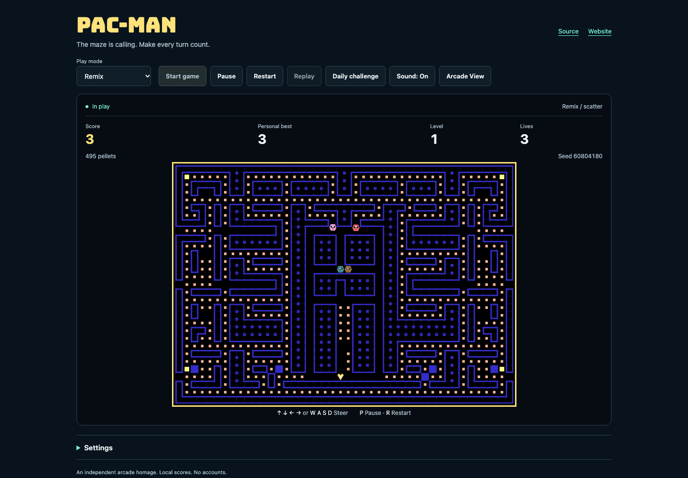

# PacMan

A static browser arcade game with four maps, four ghost personalities, seeded replays, and daily challenges. Built with JavaScript, Canvas 2D, and Web Audio. No backend or runtime dependencies.



## Play

Collect pellets and clear the maze to advance. Choose a map independently of the play mode:

- **Original Arcade:** a 28 × 31 maze with 240 dots, four energizers, one paired tunnel, a central ghost house, and arcade corner targets.
- **Remix:** the existing 44 × 31 layout.
- **Labyrinth:** a fixed 35 × 31 circuit maze with staggered crossings.
- **Procedural:** a 29 × 31 maze built from the selected seed. Candidates are checked for reachable pellets and a safe house exit.

**Standard** starts with three lives and awards a bonus life at each 10,000-point milestone. **Time Attack** starts at two minutes, counts only active play, pauses with the game, and adds 18 seconds per cleared level. **No Power Pellets** replaces energizers with ordinary dots. **One Life** starts with one life and never awards another. The selected mode and map appear in the scoreboard.

Seeds must be integers from 1 to 2,147,483,646. On fixed maps, a seed controls gameplay randomness; it does not change the maze. On Procedural, the seed also determines the maze. Apply Seed starts a fresh run. Restart keeps the current seed and map. The daily challenge uses the Procedural map, Standard mode, and a UTC calendar date; its date changes at 00:00 UTC.

| Input | Controls |
| --- | --- |
| Keyboard | Arrow keys or WASD steer; Enter starts; P pauses; R restarts; M mutes |
| Touch | Swipe the maze, use the direction pad, or select the virtual stick in Settings |
| Gamepad | D-pad or left stick steers; action buttons can be remapped in Settings |

Keyboard bindings are editable. Form fields and buttons retain their native keyboard behavior. Moving while paused does not resume play. Leaving the tab pauses an active session; resume explicitly when you return.

## Run locally

Use Node.js 22 or later:

```sh
npm ci
npm run dev
```

Open `http://127.0.0.1:4173`. A local HTTP server is required for service workers; deployment requires HTTPS. The game can also be served by any static web server.

```sh
npm run build
npm run preview
```

The build validates offline module coverage and copies the runtime to `dist/`. Preview serves it at `http://127.0.0.1:4174`. Dependencies, reports, and build output are excluded from version control.

## Engineering

- A 60 Hz fixed-step simulation uses a logical clock for phase transitions, frightened effects, fruit, and challenge timing. Pausing freezes those timers. Rendering uses its own frame schedule with bounded catch-up.
- Inputs are applied and recorded at tick boundaries. Replay schema 4 identifies the map, mode, seed, ruleset, ordered inputs, final frame, and state hash. Playback stops at the recorded final frame and reports whether the state hash matches. Older replay files can be read, but playback requires their original release because their timing rules differ.
- Player turns remain buffered until legal. Ghosts use personality targets, scatter/chase schedules, house-release conditions, frightened behavior, and swept collision checks.
- A responsive HTML scoreboard keeps text legible independently of maze scaling. Wall geometry is cached at the current display scale; dynamic actors and collectibles remain on the canvas.
- Scores, settings, daily history, and leaderboards stay in browser storage. Invalid saved records and denied storage access fall back safely. Local scores are editable by the player and are not competitive verification.
- The service worker caches one release's shell and modules together. A new release waits behind **Update Ready**; accepting it reloads the game. Offline play requires one successful online load first.

See [architecture and replay contracts](docs/architecture.md) and [validation evidence and limits](docs/validation.md).

## Checks

```sh
npm run check                       # Syntax/structure checks and Node tests
npx playwright install chromium firefox webkit
npm run test:e2e                     # Desktop Chromium, Firefox, WebKit, and mobile Chromium
npm run test:e2e:perf                # Real animation-frame pacing, no synthetic samples
npm run test:e2e:visual              # Deterministic screenshots for visual review
npm run build
npm audit
```

The browser suite builds and serves `dist/` by default. Set `PACMAN_TEST_ROOT=source` only to inspect source-server behavior. CI builds before running individual browser projects.

Visual checks attach screenshots for start, gameplay, pause, settings, and game-over states. They check layout overflow; they do not perform pixel comparisons against platform-specific goldens. Browser tests also fail on uncaught runtime errors.

The optional Lighthouse runner remains available through `LIGHTHOUSE_RUN=1 npm run test:lighthouse`; it requires Lighthouse tooling and a compatible browser.

## Accessibility and platforms

Settings include reduced motion, larger scoreboard text, high-contrast and alternate palettes, one-handed controls, and separate master/effects/music levels. Menus use native controls with visible focus. A live region announces important phase, score, and life changes.

The maze itself remains a visual game; these features do not provide a complete nonvisual play experience. Desktop Chromium, Firefox, WebKit, and a mobile Chromium profile pass the local browser suite. Firefox uses isolated application data on macOS; the upstream launch issue and workaround are recorded in [validation](docs/validation.md). Physical phones, controllers, and assistive-technology sessions still need manual qualification.

## Deployment

Upload the contents of `dist/` to a static host. Asset paths and the manifest are relative, so the site can run at a domain root or a repository subpath. The existing `CNAME` is retained; remove it from the deployment artifact if you use a different domain.

The existing stable-tag workflow builds and deploys to GitHub Pages when an authorized `v*` tag is pushed. The manual release workflow creates tags and releases only when dispatched. Neither workflow needs to run for local development.

When runtime assets change, increment `CACHE_VERSION` in `service-worker.js`. Keep the previous app running until the player accepts the waiting update. An update reload discards an unfinished session.

## License and assets

Project code is provided under the [MIT license](LICENSE). Bungee is bundled under the [SIL Open Font License](fonts/OFL.txt), with its original copyright notice, from the [Google Fonts repository](https://github.com/google/fonts/tree/main/ofl/bungee). Audio uses synthesized tones.

PAC-MAN and related characters belong to their respective rights holders. This is an independent homage, without affiliation or endorsement. Player and ghost sprites, the favicon, and the footer movie were restored from repository history. The project owner confirms holding direct authorization for the restored media; the licensing documents are maintained privately and have not been independently audited here. See the [asset register](docs/assets.md) for file origins and licensing status.

[Roadmap](ROADMAP.md)
